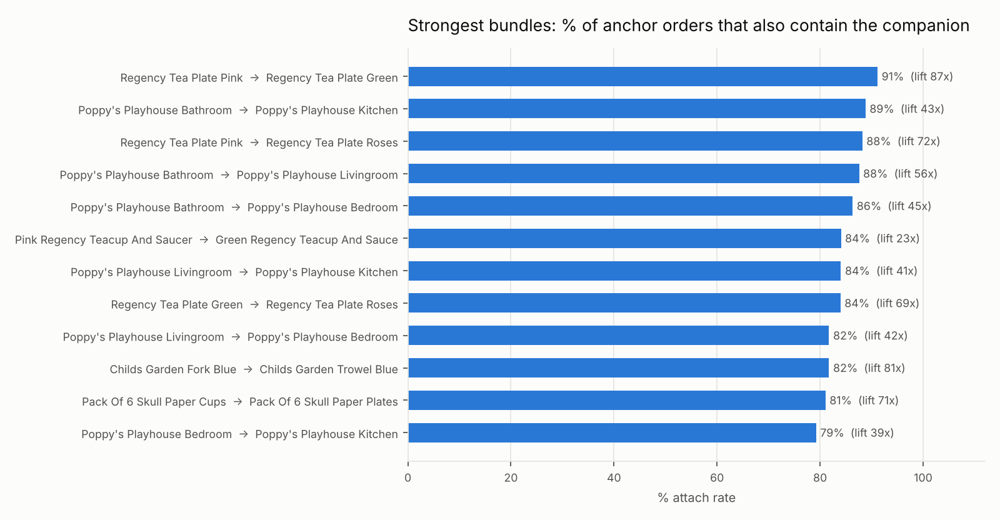
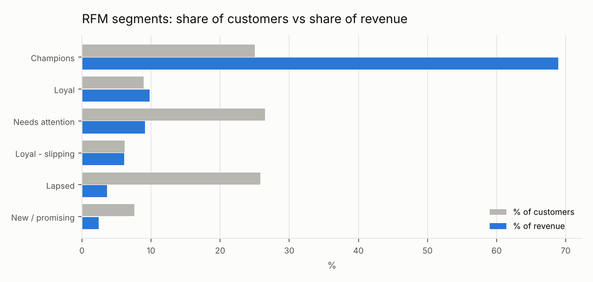

# Product Bundle & Attach Analytics

**Which products are bought together, how reliable is that signal, and which customers are worth the most?**
Market basket analysis and customer value segmentation on 1.07M real e-commerce transaction lines
(UCI Online Retail II, Dec 2009 – Dec 2011).

Python ETL → SQLite → **Apriori in SQL** (cross-checked by a sparse-matrix count in Python) →
year-by-year stability test → RFM segmentation → Excel Bundle Explorer → Power BI attach-rate model.



## Key findings
- **Minimum support matters.** 36,308 multi-product orders → 9,274 frequent pairs → 2,055 strong rules
  (attach rate ≥ 30%, lift ≥ 3). Without thresholds, single-sale products create rules with
  100% confidence and a lift of 36,308 that are just one order.
- **The rules are stable.** 88% of strong rules keep a lift of 2×+ when recomputed separately on 2010 and 2011 baskets.
- **Most strong rules are "complete the set".** 71% pair products from the same category, mostly
  colour/design siblings (Regency tea plates, Poppy's Playhouse rooms). The prompt is
  "you have 2 of 3 colours", not a cross-category bundle.
- **Attach gaps are measurable.** 2,631 orders had *Jumbo Bag Red Retrospot* without *Jumbo Storage Bag Suki*
  even though 33% of that bag's orders include it.
- **Large baskets dominate.** Orders with 11+ different products are 63% of orders and 78% of merchandise
  revenue (many customers are wholesalers).
- **Customer value is concentrated.** RFM "Champions" are 25% of identified customers and 69% of their revenue;
  360 "Loyal – slipping" customers (6% of revenue) form a concrete win-back list.

Full write-up and caveats: [`reports/findings.md`](reports/findings.md)



## Method
| Step | Detail |
|---|---|
| Baskets | 1 invoice = 1 basket; merchandise lines only (no cancellations, postage, fees, write-offs); guest orders included (basket logic does not need a customer ID); invoices duplicated across the two source sheets kept once |
| Rules | support, confidence (= attach rate), lift; thresholds: product in 300+ orders, pair in 150+ orders |
| Validation | SQL counts = independent Python sparse-matrix counts (asserted); lift recomputed per year |
| Categories | keyword rules on product descriptions (`src/etl.py`); "Other" ≈ 9% of revenue |
| Customers | RFM quintiles on identified customers; 12-month spend by acquisition quarter, with the Dec-2009 starting base kept separate |

## Deliverables
- **`excel/bundle_explorer.xlsx`**: choose any of the 150 highest-volume products → top 10 companions with
  attach rate, lift, orders with both, the attach gap and a what-if revenue column driven by an input cell
  (`INDEX/MATCH` on structured tables, data validation). Also: strong rules, RFM and cohort-value tables.
- **`powerbi/`**: Power Query scripts, DAX for the disconnected-anchor attach pattern
  (Attach Rate, Lift, Orders With Both, Companion Rank, what-if gap revenue), 12-month CLV, repeat rate and cohort retention measures, and a build guide.
- **`sql/basket_rules.sql`**: Apriori pruning with CTEs, a self-join for pairs, category attach matrix, basket-size profile.

## Run it
```bash
pip install -r requirements.txt
# put online_retail_II.xlsx in data/raw/  (see data/README.md)
python run_all.py          # ~2 minutes
python -m pytest -q
```

## Caveat
Association is not causation: lift says two products are bought together, not that recommending one will
sell the other. A bundle prompt should be A/B tested before it is rolled out.

## Data source
Chen, D. (2012). *Online Retail II* [Dataset]. UCI Machine Learning Repository.
https://doi.org/10.24432/C5CG6D — CC BY 4.0.
